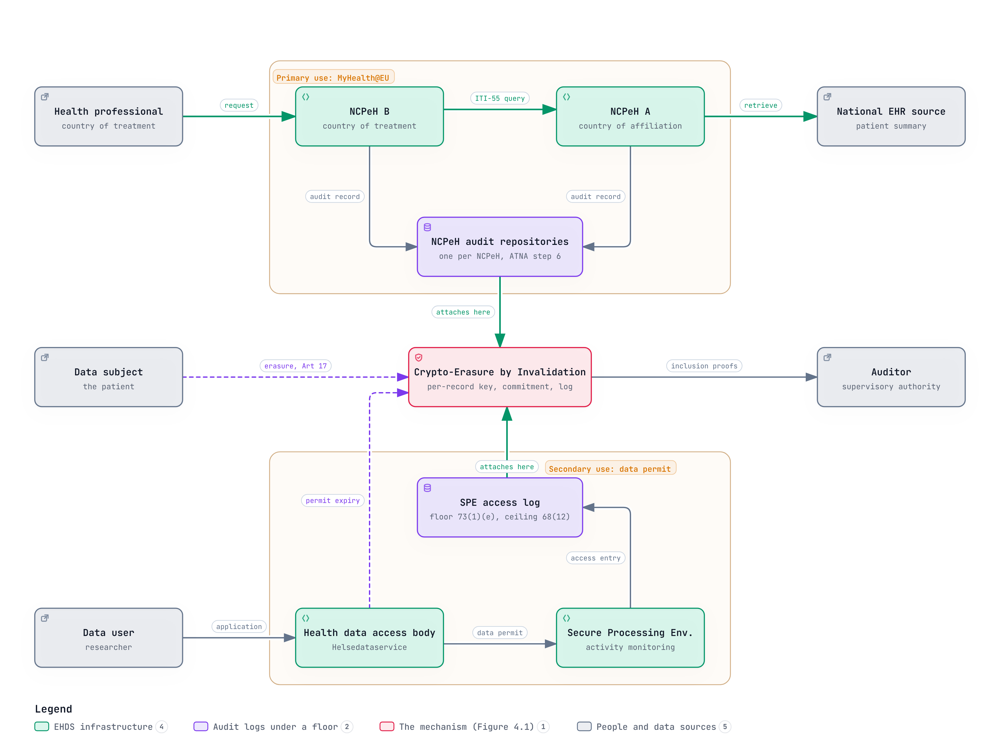
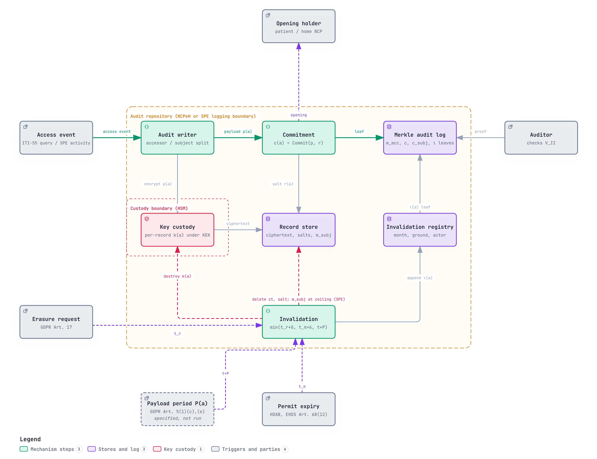
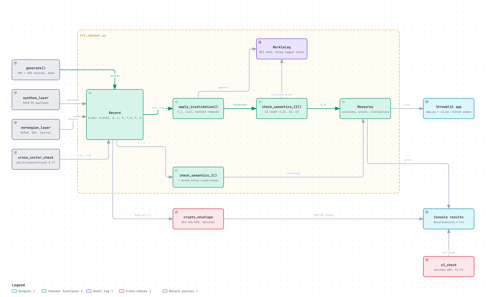

# Verifiable Crypto-Erasure for Cross-Border Health Data Audit Trails under the EHDS

**A design science study of the Tri-Lateral Retention Feasibility (TRF) problem in the Norwegian implementation context.**
MSc thesis, Master of Science in Sustainable Energy Logistics, Faculty of Logistics, Høgskolen i Molde, November 2026.
Arshad Akhtar Abbasia · Supervisor: Prof. João Ferreira

[](https://doi.org/10.5281/zenodo.23819274)
[](https://trfhimolde.streamlit.app/)
[](demo_app/)



## The problem, in one record

One audit record from cross-border health data exchange is bound by three obligations at once:

| Obligation | Source | Pulls toward |
|---|---|---|
| Retention floor | Art. 73(1)(e) EHDS (one year, SPE access logs); for the MyHealth@EU audit repository a period left to national law (six years in the Norwegian pilot, set by Helsedirektoratet as controller; Appendix D) | keep it, verifiable |
| Right to erasure | Art. 17 GDPR | remove it |
| Deletion ceiling | Art. 68(12) EHDS (six months) | remove it by a deadline |

No instrument reconciles them. The implementing acts that must specify Secure Processing Environment requirements are not due until 26 March 2027.

## What the thesis shows

The TRF Model writes the three obligations as constraints and makes one thing explicit that the law leaves implicit: **what "verifiable" means**.

- **Proposition 1.** If *verifiable* means *readable in plaintext*, the constraints are infeasible whenever an erasure or deletion deadline falls inside the retention window.
- **Proposition 2.** If *verifiable* means *accountable* (who acted, when, a hiding commitment, a logged invalidation entry), they are jointly satisfiable for every arrival pattern of requests and every retention floor.
- **Proposition 3.** A ceiling collides with a floor only if it is no longer than the floor; the event it is anchored to decides whether the collision is visible in the text or only in each record's history.
- **Proposition 4.** Under Semantics I, and assuming a controller that receives a relocated record receives the Article 17 obligation with it, moving the record out of the regulated environment meets the ceiling but not the right to erasure.



The witnessing mechanism, **Crypto-Erasure by Invalidation**, destroys a per-record payload key and keeps the accessor, event metadata, a commitment and a logged invalidation entry in a tamper-evident Merkle log.

**What is not claimed.** No novel cryptographic primitive or formal method. Informal proofs, checked by code and a bounded Z3 check. Synthetic data; the counts are not estimates of real frequency. Key destruction is *attested, not proven*. The retained residue is *pseudonymised, not anonymous*. Two principal interpretive steps, and four subsidiary premises (Chapter 3, Section 3.7), have no regulatory authority yet; Chapter 7, Section 7.4 says how the two principal steps would be settled.

## Read it

**Ten minutes:** [Abstract and Statement of Contribution](Front_Matter_v1.md) → [Chapter 4, the model and propositions](Chapter4_TRF_Model_v1.md) → [Chapter 7, conclusion](Chapter7_Conclusion_v1.md).
**Hands on:** open the [live demonstration](https://trfhimolde.streamlit.app/) and follow the examiner's walk.

| | |
|---|---|
| Whole thesis (VERA-SNARK is the project's working title) | [Word](VERA-SNARK_Thesis_SUBMISSION.docx) · [one Markdown file](VERA-SNARK_Thesis_SUBMISSION.md) |
| Front matter | [Abstract, Sammendrag, Statement of Contribution, declarations](Front_Matter_v1.md) |
| 1 Introduction | [Chapter 1](Chapter1_Introduction_v2.md) |
| 2 Literature and regulatory review | [Chapter 2](Chapter2_LitReview_v2_FINAL.md) |
| 3 Methodology (design science) | [Chapter 3](Chapter3_Methodology_v1.md) |
| 4 The TRF Model | [Chapter 4](Chapter4_TRF_Model_v1.md) |
| 5 Demonstration | [Chapter 5](Chapter5_Demonstration_v1.md) |
| 6 Discussion | [Chapter 6](Chapter6_Discussion_v1.md) |
| 7 Conclusion | [Chapter 7](Chapter7_Conclusion_v1.md) |
| Appendix A, code and outputs | [Appendix A](code_artefacts/README_Appendix_A.md) |
| Appendix B, search log | [Appendix B](Appendix_B_Search_Log.md) |
| Appendix C, evaluation instrument | [Appendix C](Appendix_C_Evaluation_Instrument.md) |
| Appendix D, correspondence with public authorities | [Appendix D](Appendix_D_Correspondence.md) |
| References | [Bibliography](Consolidated_Bibliography.md) |

## Reproduce



```bash
git clone -b joao-base https://github.com/Astheno-sphere/TRF-thesis && cd TRF-thesis/demo_app
pip install -r requirements.txt
python3 trf_checker.py          # Semantics I: 95 violations across 90 of 200 records; Semantics II: 0
python3 -m pytest -q tests/     # 56 checks: recorded runs, viewer pages, claim ledger, cross-check vs checker
```

A self-contained copy with recorded outputs is in [`repro_package/`](repro_package/). Archived on Zenodo: all versions [10.5281/zenodo.23819274](https://doi.org/10.5281/zenodo.23819274); version 1.3.0 cited in the thesis [10.5281/zenodo.23989242](https://doi.org/10.5281/zenodo.23989242).

## How this repository is kept

The thesis text changes only through gated patches ([`patches/`](patches/), [`handoff_tools/patch.py`](handoff_tools/patch.py)): a patch that would silently drop a citation, number, legal article or hedge is refused, and every cross-reference is re-checked ([`handoff_tools/concordance.py`](handoff_tools/concordance.py)). Each edit has a row in [`CHANGE_TRAIL.md`](CHANGE_TRAIL.md). Adversarial reviews are in [`RED_TEAM.md`](RED_TEAM.md) and [`red_team_round2/`](red_team_round2/); the code review and every resolution are in [`CODE_REVIEW.md`](CODE_REVIEW.md). From this repository, `repro_package/run_all.sh` reproduces every figure and `demo_app/` runs the viewer and the tests. AI assistance is declared in the Front Matter.

| Folder | Holds |
|---|---|
| top level | the thesis: chapters, appendices, bibliography, assembled submission |
| `code_artefacts/`, `repro_package/`, `figures/` | Appendix A, the reproduction package, figures |
| `patches/`, `handoff_tools/`, `CHANGE_TRAIL.md` | how every change was made and checked |
| `sources/` | primary sources the thesis relies on |
| `process/` | working records: decisions, plans, handoffs, viva preparation |
| `archive/` | superseded drafts, earlier tracked versions, supervisor correspondence, session transcripts |

## Norsk sammendrag

Masteroppgave ved Høgskolen i Molde om hvordan revisjonslogger for grensekryssende helsedata kan oppbevares, slettes og etterprøves samtidig under forordningen om det europeiske helsedataområdet (EHDS, forordning (EU) 2025/327) og personvernforordningen (GDPR artikkel 17). Oppgaven viser at kravene i modellen er uforenlige når en slettefrist faller innenfor lagringsperioden, dersom en logg bare er etterprøvbar så lenge innholdet kan leses, og forenlige dersom etterprøvbarhet betyr etterrettelighet. Analysen er gjort mot norsk infrastruktur: Helsedirektoratet som nasjonalt kontaktpunkt for e-helse (NCPeH), Helsedataservice og sikre analyserom. Hele sammendraget står i [Front Matter](Front_Matter_v1.md#sammendrag).

**Keywords:** European Health Data Space · EHDS · GDPR Article 17 · right to erasure · cryptographic erasure · crypto-shredding · audit trail · data retention · Secure Processing Environment · MyHealth@EU · NCPeH · design science research · information logistics · Norway · Helsedataservice · helsedata · personvern

## Cite

```bibtex
@mastersthesis{abbasia2026trf,
  author = {Abbasia, Arshad Akhtar},
  title  = {Verifiable Crypto-Erasure for Cross-Border Health Data Audit Trails under the European Health Data Space},
  school = {H{\o}gskolen i Molde},
  year   = {2026},
  type   = {MSc thesis},
  url    = {https://github.com/Astheno-sphere/TRF-thesis}
}
@software{abbasia2026trf_code,
  author = {Abbasia, Arshad Akhtar},
  title  = {TRF: Tri-Lateral Retention Feasibility Model},
  year   = {2026},
  version = {1.3.0},
  doi    = {10.5281/zenodo.23989242},
  note   = {All versions: 10.5281/zenodo.23819274},
  url    = {https://github.com/Astheno-sphere/TRF-thesis/tree/joao-base/demo_app}
}
```
